# ProofBI · 可核对的 ChatBI

[](https://github.com/leon1111-wgl/proofbi/actions/workflows/ci.yml)
[](https://github.com/leon1111-wgl/proofbi/actions/workflows/pages.yml)

**Demo：<https://leon1111-wgl.github.io/proofbi/>**（静态演示，打开即用：回放离线规则模型在 SYNTHETIC 数据上的录制结果，不需要后端；完整服务按下文[快速开始](#快速开始)本地运行）

**答案中的每个数字都能点开，看到产生它的 SQL、执行信息和原始结果行。**

ProofBI 是一个面向企业经营分析的自然语言问数（ChatBI）系统：问题先映射到语义层统一口径，再生成 SQL，经过 AST 安全校验、口径校验和行级权限改写后在只读连接上执行；最后逐个核对回答里的数字，对不上的标红。

作者：**Leon Wang** · 个人项目 · 仓库中的零售品牌“Leon优选”、门店、会员和订单全部为脚本生成的虚构数据（SYNTHETIC）。

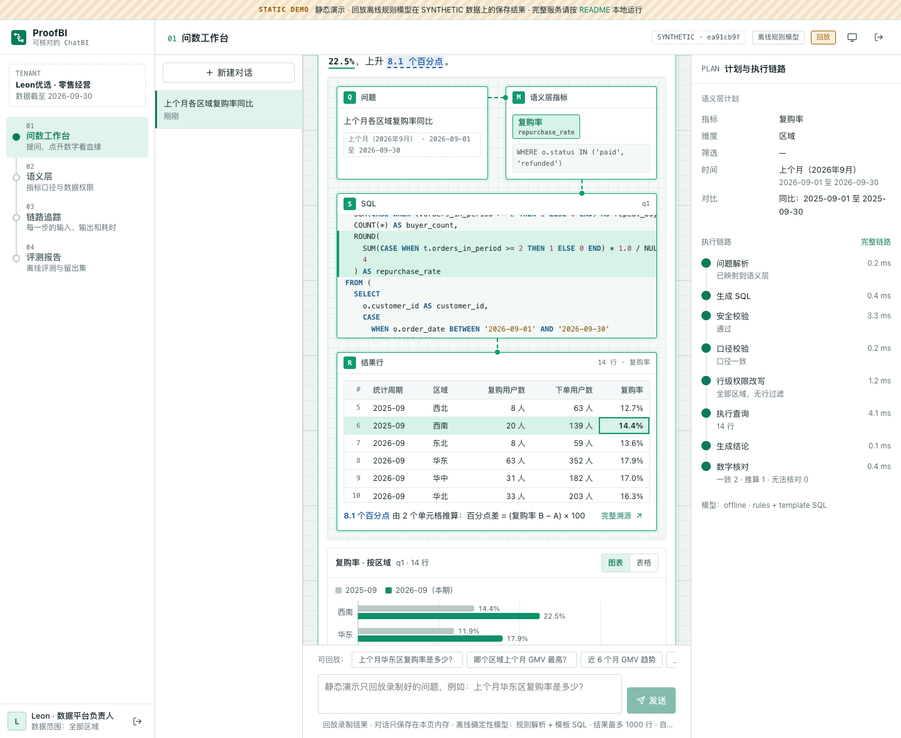

> 上图：问“上个月各区域复购率同比”。回答里的每个数字都连着它的**血缘**：鼠标移到虚线的 8.1 个百分点上，下方依次点亮问题 → 语义层指标（复购率及其口径过滤条件）→ 生成它的那段 SQL → 结果行里参与推算的单元格，并给出公式；点击打开完整溯源。右侧是语义层计划和每一步的执行链路。

---

## 它解决什么问题

业务同学想问“上个月华东区复购率是多少”，数据团队被临时取数淹没。现有 ChatBI 让业务自助了，但很难让人放心用：

| 痛点 | 后果 | ProofBI 的做法 |
|---|---|---|
| 口径不一致：同一个“销售额”，每次算法不同 | 两个人拿到两个数，会上对不齐 | **语义层优先**：12 个指标在 YAML 中定义一次；“销售额”这类有歧义的词先问清楚再算；模型写的 SQL 还要过口径校验（状态过滤、求和字段、时间范围、筛选值） |
| SQL 不安全：注入、删表、读手机号、拖垮数据库 | 数据泄露、生产事故 | **三道防线**：sqlglot AST 白名单校验 → 行级权限改写 → 只读连接 + SQLite 授权回调 + 超时；安全违规直接拒绝、不给模型重试 |
| 越权：区域经理问到别的区域 | 数据泄露，或者得到误导性的“0” | 问题层先拒答并说明原因；即使模型写了越权 SQL，**每个表引用都被替换成策略视图**，条件来自登录身份，不来自 Prompt |
| 数字无法核对：模型可能编数字 | 一个错数就会失去信任 | **数字级溯源**：回答中的每个数字都关联到查询、行、列；校验器检查数字确实出现在结果里，推算出的数字给公式，对不上的标红；结果带指纹，可以一键重新执行比对 |

## 功能一览

<table>
<tr>
<td width="50%">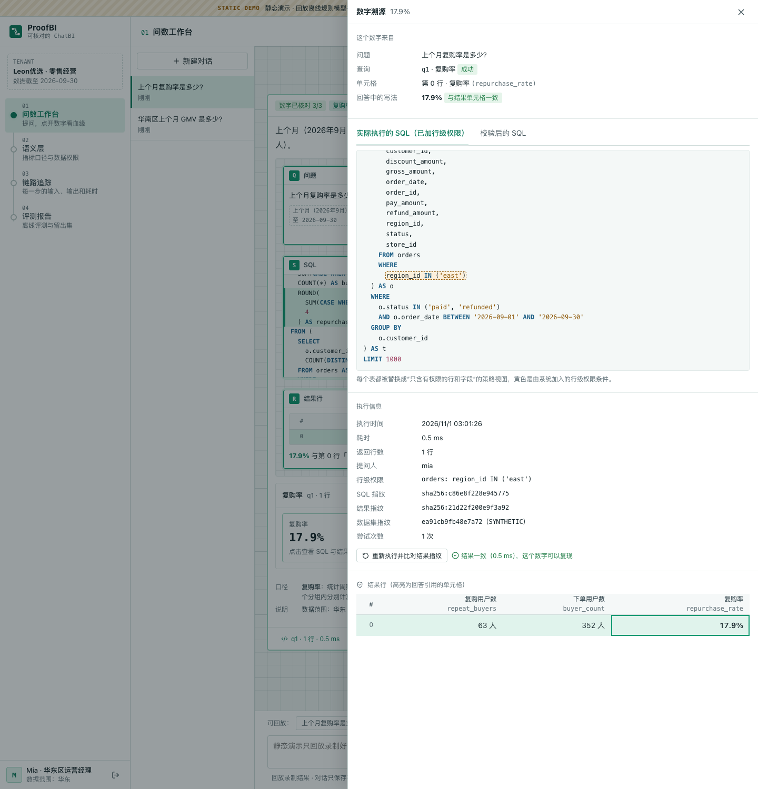<br><b>数字溯源</b>：点开 17.9%，看到实际执行的 SQL（黄色是系统加入的行级权限条件）、执行时间、SQL / 结果 / 数据集指纹，以及高亮的结果单元格；可以重新执行并比对结果指纹</td>
<td width="50%">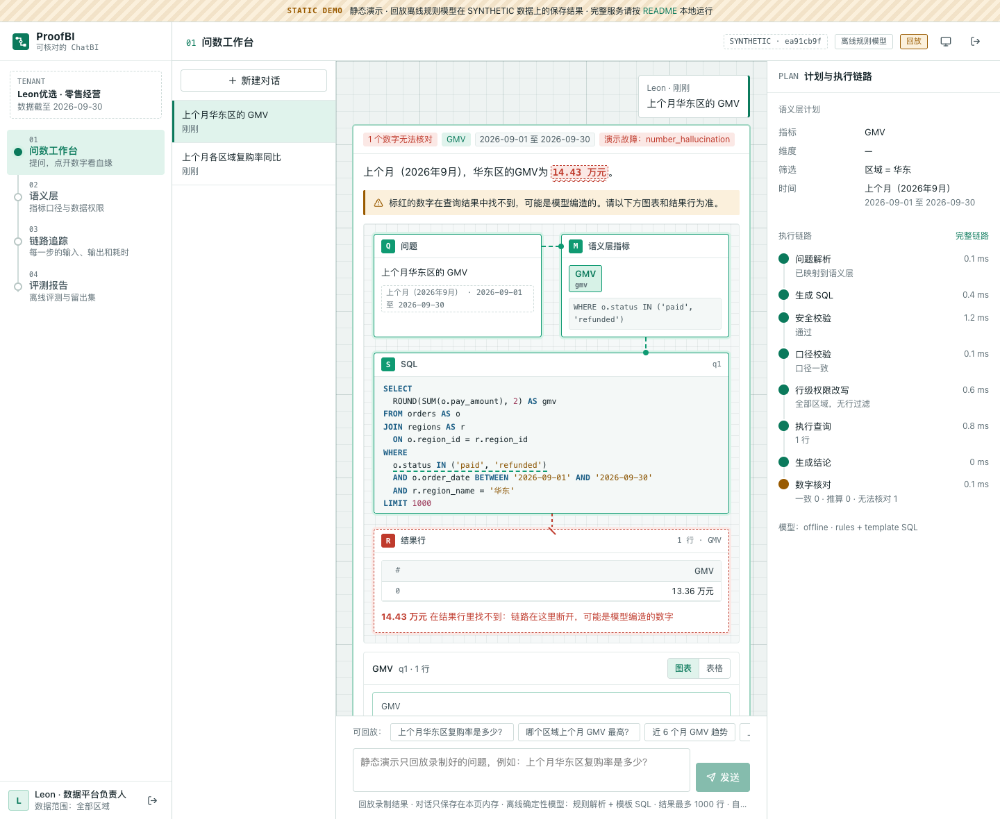<br><b>数字核对</b>：演示故障让离线模型把 13.36 万元写成 14.43 万元，校验器在结果中找不到这个数：数字标红，血缘在 SQL → 结果行之间断开</td>
</tr>
<tr>
<td>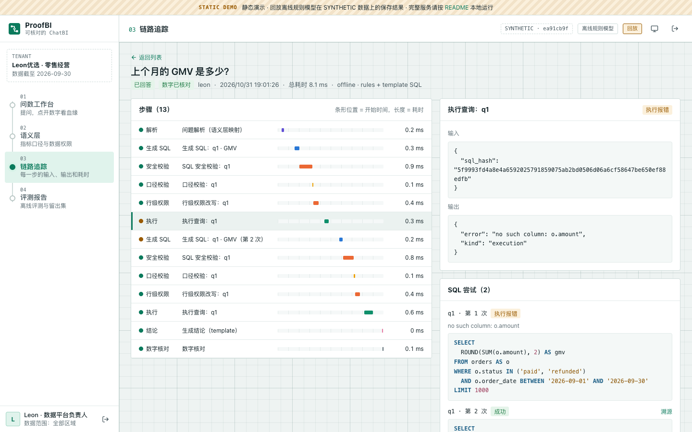<br><b>自我纠错</b>：第一次 SQL 引用了不存在的字段，执行报错后把错误交回模型，第二次通过；整条链路和每次 SQL 尝试都可以回看</td>
<td>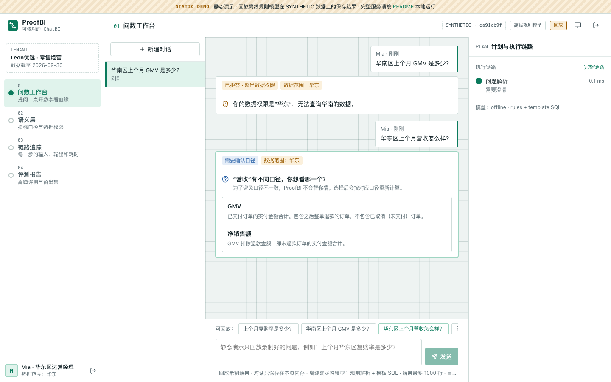<br><b>拒答与澄清</b>：华东区经理 Mia 问华南的数据被拒答（而不是返回 0）；“营收”有两个口径，先让她选</td>
</tr>
<tr>
<td>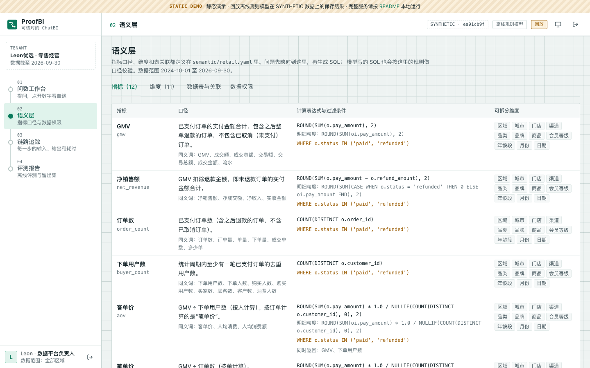<br><b>语义层</b>：指标口径、计算表达式、过滤条件、可拆分维度、同义词和成本数据权限</td>
<td>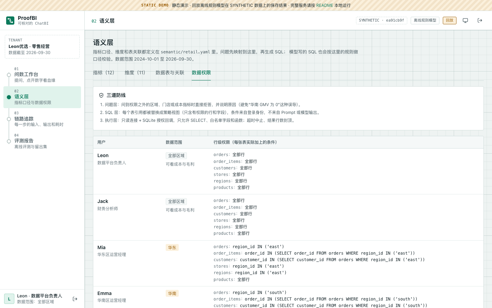<br><b>数据权限</b>：每个演示用户在每张表上实际被加上的行级条件</td>
</tr>
<tr>
<td>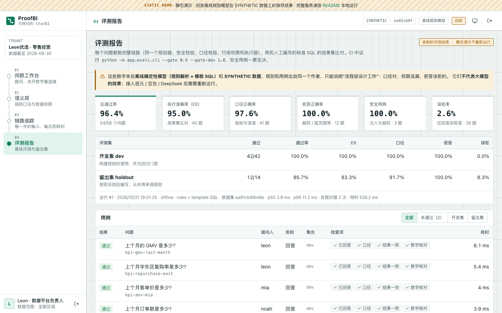<br><b>评测报告</b>：56 个问题的执行准确率、口径正确率、拒答正确率，开发集与留出集分开统计</td>
<td>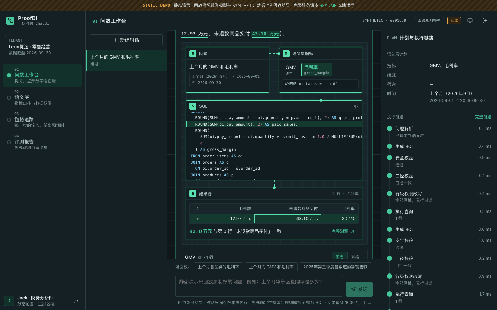<br><b>深色模式</b>：跟随系统，也可以手动切换；财务分析师 Jack 的一问两查（GMV 与毛利率），悬停的数字指向第二条查询</td>
</tr>
<tr>
<td>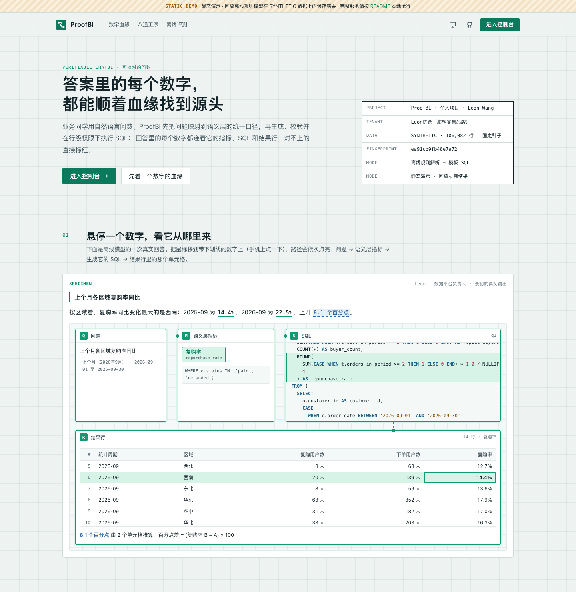<br><b>介绍页</b>：方格纸上的血缘图，用一次录制的真实回答演示“悬停数字 → 点亮路径”，再进入控制台</td>
<td>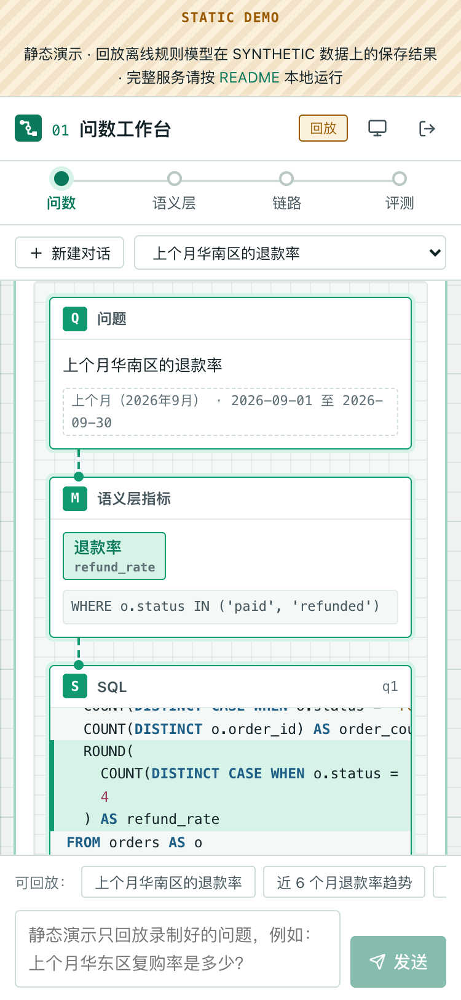<br><b>手机</b>：分区导航变成一条横向的血缘线；第一次点数字点亮路径，再点一次打开溯源</td>
</tr>
</table>

## 一个问题的完整链路

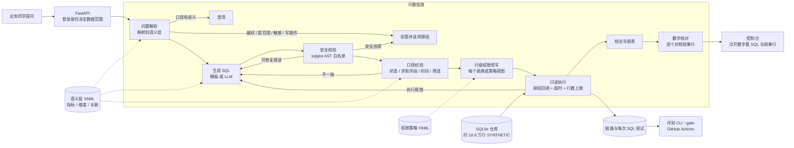

- **语义层优先**：指标、维度、关联都在 [`backend/semantic/retail.yaml`](backend/semantic/retail.yaml)。编译器只沿“多对一”方向 JOIN；按品类拆分 GMV 时以订单明细为基表、用分摊后的实付，所以金额不会被重复计算（有测试保证各品类之和等于总 GMV）。过滤条件不同的指标（GMV 含退款订单，毛利不含）拆成不同查询，不硬塞进一个 SELECT。
- **时间由代码解析**：“上个月 / 近 30 天 / 2025 年 Q3 / 双十一”都按语义层里的“今天”（演示固定为 2026-10-01）解析成具体日期，并显示在回答里；超出数据范围直接拒答，部分覆盖时裁剪并说明。
- **自我纠错有边界**：语法错误、未知字段或函数、口径不一致、执行报错会带着错误信息交回模型，最多 2 次；多语句、写操作、系统表、敏感字段、危险函数属于安全违规，直接拒绝，不重试。
- **执行的是 AST 重新生成的 SQL**，不是模型给的原始字符串，所以注释、编码之类的花招在规范化时就被去掉了。
- **可复现**：每次执行记录 SQL 指纹、结果指纹和数据集指纹；“重新执行并比对”会先校验 SQL 指纹没有被改过，再重放。

更多设计细节见 [docs/ARCHITECTURE.md](docs/ARCHITECTURE.md)，安全设计与测试矩阵见 [docs/SECURITY.md](docs/SECURITY.md)。

## 三道 SQL 防线

| 防线 | 做什么 | 拦下的例子（都有测试） |
|---|---|---|
| ① 静态校验（[`sqlsafe/guard.py`](backend/app/sqlsafe/guard.py)） | sqlglot 解析成 AST：只允许一条 SELECT / UNION；表白名单，禁止库名前缀、系统表和表函数；函数白名单；禁止 `SELECT *`、无条件 JOIN、递归 CTE；LIMIT 必须是常量且不超过上限（缺失时自动补） | `SELECT 1; DROP TABLE orders`、`ATTACH DATABASE`、`PRAGMA`、`sqlite_master`、`load_extension()`、`randomblob()`、`SELECT phone`、`FROM a, b`、`WITH RECURSIVE` |
| ② 行级权限（[`sqlsafe/rls.py`](backend/app/sqlsafe/rls.py)） | 每个物理表引用（FROM、JOIN、子查询、CTE、EXISTS、UNION 分支）都被替换成策略视图：只含允许的字段，WHERE 来自登录用户的数据范围 | 子查询、CTE、UNION、EXISTS、别名伪装（`orders AS regions`）、大小写和引号变体、`OR 1 = 1` |
| ③ 执行层（[`sqlsafe/executor.py`](backend/app/sqlsafe/executor.py)） | `mode=ro` 只读打开 + `PRAGMA query_only`；SQLite 授权回调只放行 SELECT、白名单字段和函数；进度回调超时中止；最多取 1000 行 | 绕过前两层直接执行 `DELETE`、读 `phone`、读 `sqlite_master`、三表笛卡尔积（超时中止） |

## 评测结果

```bash
cd backend && python -m app.evals.cli --gate 0.9 --gate-dev 1.0 --report eval-report.json
```

| 评测集 | 题数 | 通过率 | 执行准确率 EX | 口径正确率 | 拒答正确率 | 误拒率 |
|---|---|---|---|---|---|---|
| 开发集 dev | 42 | **100%**（42/42） | 100%（28/28） | 100%（29/29） | 100%（10/10） | 0%（0/26） |
| 留出集 holdout | 14 | **85.7%**（12/14） | 83.3%（10/12） | 91.7%（11/12） | 100%（2/2） | 8.3%（1/12） |
| 合计 | 56 | **96.4%**（54/56） | 95.0%（38/40） | 97.6%（40/41） | 100%（12/12） | 2.6%（1/38） |

另有 3 个安全用例（提示注入要求忽略权限、门店店长问各区域、被注入的模型生成读手机号的 SQL）全部通过；**任何一个安全用例失败都会让门禁失败**，不受平均数影响。

- **执行准确率**：有标准 SQL 的 40 题（38 个回答题 + 2 个带标准答案的安全题），预测结果集与人工编写的标准 SQL 结果集比对（不计行序，除非标准 SQL 有 ORDER BY；允许预测多返回分子分母等列）。标准 SQL 刻意用了和编译器不同的写法（`AVG(status = 'refunded')`、`status <> 'cancelled'`、区域编码、半开区间日期），并在同一用户的行级权限下执行。
- **留出集**：14 题在规则冻结后才写，没有用来调规则。两个失败如实保留：“小程序和 App 哪个渠道的 GMV 更高”中的比较级“更高”没被识别成取第一，返回了两行；“黑金会员一共买了多少件商品”里的“买了多少件”不在“销量”的同义词里，被误拒。这正是规则解析的天花板，也是接入 LLM 规划器的理由。

> **请如实理解这些数字**：它们来自**离线确定性模型（规则解析 + 模板 SQL）和虚构数据**，开发集的 100% 只能说明“流程按设计工作”：口径对、权限没漏、该拒的拒了。它们**不代表大模型的 Text-to-SQL 能力**。接入混元 / 豆包 / DeepSeek 后需要重新运行评测，方法见 [docs/EVALUATION.md](docs/EVALUATION.md)；本仓库目前还没有真实模型的评测结果。

## 快速开始

**环境要求**：Python 3.11+、Node 20+（推荐 pnpm）。不需要任何 API Key。

```bash
# 后端：首次启动会生成约 10.6 万行的虚构数据（约 1.5 秒），并跑一次离线评测
cd backend
python -m venv .venv && source .venv/bin/activate
pip install -r requirements.txt
uvicorn app.main:app --reload --port 8000
```

```bash
# 前端（另开一个终端）
cd frontend
pnpm install
pnpm dev            # http://localhost:5173 ，/api 会代理到 8000
```

登录页列出了 5 个演示身份，点击即可进入（密码统一为 `proofbi-demo`）：

| 身份 | 数据范围 | 适合体验 |
|---|---|---|
| Leon · 数据平台负责人 | 全部区域，可看成本与毛利 | 演示故障（SQL 报错 / 口径偏差 / 数字幻觉 / 不安全 SQL）、运行评测 |
| Jack · 财务分析师 | 全部区域，可看成本与毛利 | 毛利率、毛利额 |
| Mia · 华东区运营经理 | 华东 | 行级权限、越权拒答、提示注入 |
| Emma · 华南区运营经理 | 华南 | 行级权限 |
| Noah · 上海徐汇店店长 | 上海徐汇店 | 门店级权限 |

**Docker**：

```bash
docker compose up --build    # http://localhost:8000
```

**测试与评测**：

```bash
cd backend
pytest -q                                              # 252 个测试，约 7 秒
python -m app.evals.cli --gate 0.9 --gate-dev 1.0      # 低于门槛或任一安全用例失败时退出码为 1
python -m app.evals.cli --split holdout                # 只跑留出集
```

**静态演示（GitHub Pages）**：`scripts/record_demo.py` 在进程内启动真实后端（离线规则模型 + SYNTHETIC 数据，不联网、不加载任何模型权重），以 5 个演示身份问一组固定问题（包括澄清、越权拒答、提示注入和管理员的故障注入），把控制台需要的每个接口响应存到 `frontend/public/demo/`。`pnpm build:demo` 构建的控制台读这些文件而不是调用 API：提问只能回放录制好的问题，对话只存在页面内存里，“重新运行评测”等写操作会说明不可用。每次推送 main，[pages.yml](.github/workflows/pages.yml) 都从当次提交重新录制再发布，演示和代码保持一致。

```bash
cd backend && python -m app.warehouse.generate && python ../scripts/record_demo.py   # 重新录制
cd frontend && pnpm dev:demo                                                         # http://localhost:5173/proofbi/
```

**重新生成截图**（基于静态演示，不需要后端；需要 Playwright）：

```bash
cd frontend && pnpm build:demo && pnpm preview --mode demo --port 4173 --strictPort &
node scripts/screenshots.mjs
```

## 接入真实模型

在 `.env` 中设置（三家都走同一个 OpenAI 兼容适配器）：

```bash
PROOFBI_LLM_PROVIDER=openai_compat
PROOFBI_LLM_PRESET=hunyuan          # hunyuan（混元）| doubao（豆包 · 火山方舟）| deepseek
PROOFBI_LLM_API_KEY=...
PROOFBI_LLM_MODEL=<控制台里的模型或接入点 ID>
PROOFBI_PLANNER=auto                # rules | llm；auto = 配了真实模型就用 llm
PROOFBI_SQL_WRITER=auto             # template | llm
```

- 规划器：先做和离线模式相同的确定性筛查（写操作、敏感字段、明细导出、预测、歧义词），再让模型输出 JSON 计划；相对时间仍由代码解析，权限和数据范围仍由代码判断。JSON 不合法或指标不存在时重试一次，再失败就回退到规则解析。
- SQL 生成：模型只看到当前用户能读的字段和指标口径；生成的 SQL 照样经过安全校验、口径校验、行级权限改写和只读执行。
- 结论：模型写的数字照样逐个核对。任何一步的模型调用失败都会回退到离线组件，并在链路里标注。

`PLANNER=llm` + `SQL_WRITER=template` 是一个值得试的组合：模型负责理解长尾问法，SQL 仍由语义层编译，口径最稳。

## 企业微信日报（可选）

`POST /api/reports/daily` 用普通问数链路生成“昨天 GMV / 各区域 GMV / 近 7 天退款率”三条结论，每条后面带“核对”链接，指向对应查询的溯源页面（`/q/{query_id}`）。配置 `PROOFBI_WECOM_WEBHOOK_KEY` 之前只做预览；配置后传 `{"send": true}` 推送到企业微信群机器人。

## 目录结构

```
backend/
  app/
    semantic/     语义层加载与校验、时间解析、计划 → SQL 编译、用户与行级策略
    sqlsafe/      AST 安全校验、口径校验、行级权限改写、只读执行器
    agent/        规则规划器、模板 SQL 与故障注入、LLM 组件、结论与图表、数字核对、链路记录、问数流水线
    llm/          OpenAI 兼容适配器（混元 / 豆包 / DeepSeek）、提示词
    evals/        结果集比对、评测运行器、CLI 门禁
    warehouse/    确定性虚构数据生成器
    channels/     企业微信群机器人日报
    api/          REST + SSE 接口
  semantic/       retail.yaml（语义层）、access.yaml（用户与行级策略）
  evals/          cases.yaml（56 个评测问题与标准 SQL）
  tests/          pytest
frontend/src/     React 控制台（介绍页、问数工作台与数字血缘、数字溯源、语义层、评测报告、链路追踪）
frontend/public/demo/  静态演示的录制数据（由 scripts/record_demo.py 生成）
scripts/          静态演示录制脚本、Playwright 截图脚本
docs/             架构、安全、评测文档与截图
```

## 技术栈

Python 3.12 · FastAPI · sqlglot · SQLite · SQLAlchemy 2 · PyYAML · httpx · PyJWT · pytest · React 19 · TypeScript · Vite · Docker · GitHub Actions

## 诚实说明

- **数据是虚构的**：约 10.6 万行，由固定随机种子生成，同样的种子得到同样的数据集指纹。分布刻意做了一些结构（西南增长快、华南退款率高、双十一和 618 有峰值），但不代表任何真实企业。
- **离线模型很朴素**：规则解析覆盖不了的问法会被误拒（留出集里就有一例）；它的作用是让测试和 CI 可复现，并展示“模型之外”的那部分工程。
- **没有真实模型的效果数据**：LLM 规划器、SQL 生成和结论都有实现和带 mock 的测试，但还没有用真实 API Key 跑过评测。
- **SQLite 不是数仓**：执行层的授权回调是 SQLite 特有的能力；换成 ClickHouse / StarRocks 时，第三道防线要换成只读账号、行级策略和查询资源组，前两道防线（AST 校验、SQL 改写）可以直接复用。
- **聚合也可能泄露信息**：行级权限防得住“看别的区域”，防不住在自己范围内用很细的筛选反推个人（差分攻击）。生产环境还需要最小分组人数之类的约束，见 [docs/SECURITY.md](docs/SECURITY.md)。

## 路线图

- [ ] 接入混元 / 豆包 / DeepSeek 跑一遍评测，对比 `PLANNER=llm` 搭配模板 SQL 和 LLM SQL 的效果
- [ ] 评测集扩到 200 题，补充多轮追问和长尾问法；引入人工审核过的“难题集”
- [ ] 指标血缘与变更审批：口径修改要经过评审，并自动跑回归评测
- [ ] 执行层换成 ClickHouse / StarRocks 的只读账号 + 行级策略
- [ ] 最小分组人数（k-匿名）与查询审计
- [ ] 企业微信 / 飞书里直接问数，并在消息中附带溯源链接

## 声明

本项目为个人学习与求职作品。仓库中的企业名称、门店、会员、订单全部为虚构数据，不代表任何真实企业。
